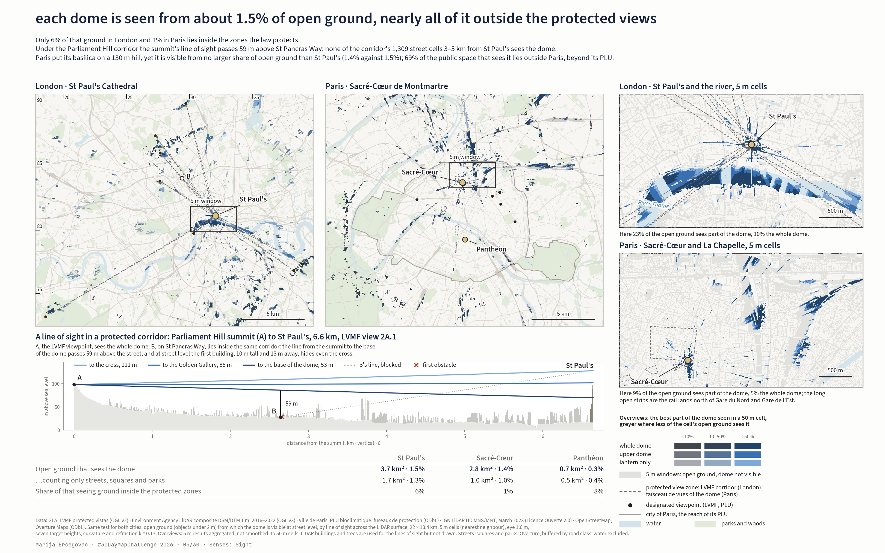

# Day 5, Senses: Sight. What London is allowed to see

Day 5 compares two cities with a law on views: London's LVMF corridors to St Paul's and Paris's fuseaux de protection to the
Sacré-Cœur and the Panthéon, with the same LiDAR viewshed for both. The day's main picture is the comparison figure; this folder holds
the London analysis behind its left panel; the Paris half and the script of the figure (`paris/`) are kept locally and are not
in this repository yet.



Frames, in reading order (EN; Russian versions next to each): the comparison `map_en.png` (both cities at 50 m, a 5 m window
for each, one real line of sight through a protected corridor, three numbers per dome); the detail `map_en_detail.png` (two zoom windows at the model's 5 m and three real lines of sight in London);
the London sheet `map_en_london.png`; the 3D still `map_en_3d.png`. Video: a 3D close-up of St Paul's with the three lines of sight
(27.9 s, `scene3d.py`), posted with the day; the video files are not stored here.
Interactive: `index.html`, one self-contained file (both cities at the same ground scale, layer switches, click to read a cell).
Style: one quiet base (OS Open Zoomstack Light in London, IGN PLAN.IGN and Apur blues in Paris); the LiDAR buildings and trees
are used for the lines of sight but not drawn.
Local element (Ordnance Survey sheet habit): National Grid ticks every 5 km with the two-digit grid numbers of 100 km square TQ on
the London panel, as on the OS-style London sheet. Data element: the line of sight cut through the LiDAR surface (Parliament Hill
to St Paul's, with St Pancras Way under it). Every image ends with the series signature in monospace
(`styles.common.signature`). Titles state the finding.

## Question

The London View Management Framework (LVMF) protects eight view corridors from hills and the river towards the dome of
St Paul's Cathedral. What does that protection actually buy at street level: from how much of the city's open ground is the
dome visible, how much of that ground lies inside the corridors, and how much of the corridors' own ground sees the dome at all?

## Data and licences (downloaded 4 November 2026)

| Source | What was used | Licence |
|---|---|---|
| GLA, London Datastore: [LVMF protected vistas, GIS files](https://data.london.gov.uk/dataset/lvmf-protected-vistas-gis-files) | 43 polygons: 14 Viewing Corridors (VC) and 29 Wider Setting Consultation Areas (WSCA), digitised from the LVMF SPG of July 2010; 8 corridors target St Paul's, the rest Westminster, Tower Bridge and the White Tower | OGL v2 |
| Environment Agency, Defra DSP: [LIDAR Composite First Return DSM 1 m](https://environment.data.gov.uk/dataset/df4e3ec3-315e-48aa-aaaf-b5ae74d7b2bb) | surface with objects, flights 11 Nov 2016 to 5 May 2022, via WCS with nearest-neighbour resampling to 5 m | OGL v3, © Environment Agency 2022 |
| Environment Agency, Defra DSP: [LIDAR Composite DTM 1 m](https://environment.data.gov.uk/dataset/13787b9a-26a4-4775-8523-806d13af58fc) | terrain, flights 6 Jun 2000 to 2 Apr 2022, same way | OGL v3 |
| OpenStreetMap via Nominatim | cathedral footprint, way 369161987 | ODbL |
| Overture Maps, release 2026-10-21.0, theme base/water | water polygons for the base map, read with DuckDB from S3 | ODbL (OSM-derived) |

Raster extent: British National Grid E 517 800–539 800, N 172 400–190 800 (22 × 18.4 km), 5 m, 4400 × 3680 cells, no gaps.

## Method

1. Dome axis: the highest 1 m DSM cell inside the OSM footprint, E 532 054.5, N 181 142.5, 119.0 m AOD with the ground at 16.8 m
   (LiDAR catches the lantern at 102 m above ground; the thin cross at 111 m it does not). The OSM centroid is 10 m to the west.
2. The cathedral's own body (footprint + 8 m) is flattened to the ground in the obstacle surface, so that the axis stands for the
   dome's silhouette instead of hiding behind its own roof.
3. Rays from the axis outwards in 2.5 m steps, with an angular step that keeps neighbouring rays 2.5 m apart at the raster's edge
   (17 km). For every cell the eye is at DTM + 1.6 m and the target is the axis at seven heights above the cathedral's ground:
   111 m (cross), 100 (lantern), 85 (Golden Gallery), 70, 53 (Stone Gallery, base of the dome), 40 (peristyle), 25 m. A cell sees
   a level if the slope from the target to the eye is not below the running maximum of slopes to the obstacle tops between them.
   Earth curvature and refraction with k = 0.13: 17 m lost over 16 km. Numba, 1.8 s for the whole raster.
4. Shown only on open ground and water (objects in the DSM under 2 m); buildings and trees in grey by height. Three classes by the
   lowest visible level: whole dome (≤ 53 m), upper dome (70–85), only the lantern and cross (100–111).
5. Viewing places: the apex of each VC polygon, the vertex farthest from St Paul's (in this dataset every landmark lies closer to
   St Paul's than its viewing place).

6. Display: the overview (comparison frame) aggregates the 5 m result to 50 m cells (block sums, no interpolation or smoothing).
   A cell's colour is the best part of the dome seen from any of its open 5 m cells (whole dome, upper dome, lantern only, the
   three lightnesses of the 5 m maps); its saturation is the share of its open ground that sees the dome (up to 10 %, 10–50 %,
   over 50 %), so sparse cells read grey. The protected zones are thin grey dashed outlines, the city of Paris a thin solid line:
   the data keep the colour. The 5 m windows, the detail frame and the interactive page show the 5 m cells themselves. Sections sample the 5 m surfaces every 2.5 m along the line with the same rule, viewers at cell centres.
7. Public space: Overture road segments of 17 classes (motorway to footway, tunnels dropped) buffered by a class half-width
   (10 m for motorways to 1.5 m for footways), plus parks, gardens, playgrounds, commons and plazas, intersected with open ground;
   water excluded (`public_space.py`).

Stack: numpy and numba for the ray viewshed (`sight.py:_rays`), rasterio for the rasters, geopandas and shapely for the corridors,
footprint and water, pyproj for the grid, DuckDB (httpfs + spatial) to read Overture Maps from S3, matplotlib for the maps,
the series' style modules in `shared/styles` for the sheet.

## Findings (`data/derived/stats.json`)

- Open ground in the extent: 241 km²; sees the dome: 3.66 km² (1.5 %); sees the whole dome: 0.84 km². Within 10 km: 3.26 of 163 km².
- Eight VC corridors to St Paul's: 3.86 km², of which 1.82 km² open ground; 0.22 km² of that sees the dome (12 %), 0.07 km² the whole dome.
- 94 % of the ground that sees the dome lies outside the corridors; 86 % outside corridors and consultation areas.
- Counting only public space (Overture streets, footways, squares and parks; water excluded): 135 km², of which
  1.74 km² (1.3 %) sees the dome and 0.44 km² the whole dome;
  96 % of that lies outside the corridors, and 93 % of the corridors' public space sees nothing.
  33 % of all the open ground that sees the dome is the surface of the Thames.
- Street-level public space inside the corridors, 3 to 5 km from the dome: none of 2,066 cells (Alexandra Palace),
  1,309 (Parliament Hill), 1,512 (Kenwood), 1,960 (Blackheath) and 1,389 (King Henry's Mound)
  sees the dome; 48 of 887 do under Primrose Hill and 142 of 2,621 under Greenwich (5 m cells).
- Paris, same rules (`paris/data/derived/stats.json`): the Sacré-Cœur is seen from 1.0 % of public space
  (1.03 km²), 97 % of it outside its faisceau de vues and 69 % outside Paris;
  88 % of the faisceau's public space sees nothing.
- The three sections of the detail frame reproduce the map exactly at their cells: A, the Parliament Hill summit (6.6 km), sees the
  whole dome; B, St Pancras Way inside the same corridor (4.0 km, 14 m off the summit's line), sees nothing, its first obstacle
  a 10 m building 13 m away, while the summit's line to the base of the dome passes 59 m above that street; C, Waterloo Bridge
  (1.4 km), sees the whole dome. From some deck cells of the bridge an 18.5 m line of trees on the Embankment, 170 m away, hides
  the base of the dome.
- Per corridor (share of open ground seeing any part): Alexandra Palace 5 %, Parliament Hill 7 %, Kenwood 5 %, Primrose Hill 8 %,
  Greenwich 19 %, Blackheath 12 %, Westminster Pier 59 %, King Henry's Mound 21 %.
- At the viewing places themselves the model sees the dome down to the 40 m level (the whole dome) from Alexandra Palace, Parliament
  Hill, Kenwood, Primrose Hill, Greenwich and Blackheath. Westminster Pier: the cell itself holds a 7.3 m object (canopy or trees),
  neighbouring cells see only the lantern. King Henry's Mound: nothing, neither at the point nor within 30 m (the hedge; the famous
  keyhole is narrower than a cell).
- Check points: south end of the Millennium Bridge sees the upper dome (85 m), Waterloo Bridge the whole dome (53), the riverside at
  Tate Modern the whole dome (40), the middle of Tower Bridge only the lantern (100). A point on the Thames off Blackfriars is blocked
  by a moored vessel 8 m away (19 m in the DSM): an artefact of the surface, not of the rays.

### Sensitivity (`stats.json["sensitivity"]`, `sensitivity.py`)

| Check | Result |
|---|---|
| Open-ground threshold 1 m / 2 m / 3 m instead of 2 m | ground that sees the dome 3.5 / 3.7 / 3.8 km²; blind share inside the corridors 87 / 88 / 89 %; share of the seeing ground outside the corridors 94 % in every case |
| Public space (streets, footways, squares, parks) instead of all open ground as the denominator | London 1.3 % instead of 1.5 %, blind inside the corridors 93 % instead of 88 %, outside the corridors 96 % instead of 94 %; Paris (Sacré-Cœur) 1.0 % instead of 1.4 % |
| 1 m instead of 5 m cells, 2 × 2 km square centred on the dome, observers within 1 km | at 5 m, 32 % of the open ground sees some part of the dome and 18 % the whole dome; at 1 m, 24 % and 12 %. Lamp posts, parked vehicles, walls and single trees that a 5 m cell swallows block the near view, so the 5 m map overstates visibility close to the cathedral by roughly a third; the headline shares at city scale come from the hills, the river and the parks, where the two agree |

## So what

- The GLA is preparing new LVMF London Plan Guidance (Director Decision DD2662, 4 December 2023: a review with 3D modelling,
  longer background areas, refined consultation areas). The choice the map puts in numbers is live: the framework guards a line
  in the sky from eight summits, while 88 % of the ground under those lines sees nothing of the dome, and 94 % of the ground that
  does see it has no corridor at all. Protecting views from streets, bridges and parks is a different instrument, and the City of
  London has run one since 1938 (St Paul's Heights) for the river views that this map finds strongest.
- Read the other way, for developers and visual-impact consultants: on the seeing ground outside the corridors a tall building can
  take the dome out of a real view without breaching any LVMF vista. The map is a first screen for where that is.
- For the 30DayMapChallenge audience: a viewshed is a cheap, reproducible way to test a planning rule against the city it protects;
  the whole computation runs in two seconds on open LiDAR.

## Limitations

- The corridors are digitised from the SPG of 2010; the current edition is 2012 and new guidance is in preparation. The corridor
  heights (threshold planes) are not in the data; this is plan geometry only.
- The DSM is a composite of flights from 2016 to 2022: towers completed later (in the City and on the South Bank) are missing. Trees
  in the first-return DSM are opaque: the flights are mostly winter ones, but conifers and dense crowns block the ray in the model
  and in summer.
- Resampling from 1 m to 5 m by nearest neighbour closes narrow gaps (the hedge at Richmond) and turns single objects (vessels,
  canopies, lamp posts) into 5 × 5 m walls. Invisible at the overview scale, visible in point checks.
- The target is the dome's axis, not its surface; for nearby points (up to ~300 m) the lower levels are hidden by the cathedral's
  body, which is removed from the obstacles. "Whole dome" there means "the axis is visible down to 53 m".
- "Sees" for a cell means "at least one ray through the cell sees"; neighbouring rays can disagree.
- "Outside any corridor" means outside the LVMF corridors: the views from the river and the bridges between Hungerford Bridge and
  London Bridge have been protected since 1938 by the City's St Paul's Heights (see above), so "unprotected" would be wrong for the river.
- Water is treated as open ground: visibility from a boat, not from the embankment. On the Thames, 9 % of the water cells in the
  whole extent see the dome, and they make 33 % of all the seeing ground; the public-space check drops them.
- The public-space mask is an approximation: road widths come from the class, not from survey; OSM "garden" also covers some private
  gardens; rail land, cemeteries and private courtyards are left out.
- The 50 m overview colours a whole cell when part of it sees the dome, and by the best part seen anywhere in it; saturation (the
  share of the cell) greys sparse cells, but the drawn area is larger than the seeing area. Areas and shares are always counted on
  the 5 m cells.

## Prior work on the topic (searched 4 November 2026)

Searched: London Datastore and london.gov.uk, City of London, Historic England, Crossref and tandfonline, GitHub, Observable, LinkedIn
and Mastodon via web search, past 30DayMapChallenge entries. Closest to this map:

| Work | What they showed | How this map differs or builds on it |
|---|---|---|
| Sam Bowyer, [Mapping Visibility: Applying Zone of Theoretical Visibility Analysis to St Paul's Cathedral](https://sambowyergis.com/gis/spatial%20analysis/2026/04/12/ztv-stpauls-viewshed.html), 12 April 2026 | Binary viewshed of the cathedral in QGIS 3.44 (built-in Viewshed) on a LiDAR DSM resampled to 5 m, observer at the top of the dome, target 1.6 m, 20 km radius, about 50 minutes of processing; the pattern is "consistent" with the LVMF corridors | Same set-up, but seven target heights (which part of the dome is seen), earth curvature, the cathedral removed from the obstacles, open ground only, and above all numbers against the corridors (88 % inside see nothing, 94 % of the seeing ground is outside); numba in 1.8 s. The direct predecessor |
| HelenMakesMaps, [How to run visibility analysis in QGIS](https://www.helenmakesmaps.com/post/how-to-run-visibility-analysis-in-qgis), 14 March 2025 | A reverse viewshed of the Houses of Parliament in QGIS: a 5 m grid of points over the building, Environment Agency first-return DSM at 2 m, target 1.6 m, 5 km radius, the viewsheds added up and styled as light from the building | The same reverse question for another London landmark; this map adds the legal layer, the parts of the target and the numbers |
| City of London Corporation, [Protected Views SPD](https://www.cityoflondon.gov.uk/assets/Services-Environment/planning-spd-protected-views-spd-2012.pdf), adopted 31 January 2012; [St Paul's Heights Study, 2015](https://www.cityoflondon.gov.uk/assets/Services-Environment/planning-protected-views-tall-buildings-st-pauls-heights-study-part-1-2015.pdf); layer [St Pauls Heights Policy Area](https://www.data.gov.uk/dataset/st-pauls-heights-policy-area8) | "St Paul's Heights": since 1938 (Godfrey Allen's 1937 proposals) a grid of height limits keeps the views of the dome, western towers and entablature from the South Bank and the bridges between Hungerford Bridge and London Bridge, plus setbacks on Fleet Street, Ludgate Hill, Watling Street and Cannon Street; the values are unchanged since the 1937 maps | Explains the main "no corridor" result: the river view is protected, but by another instrument and another authority. Added to the map's callout and to the posts |
| GLA, [LVMF SPG, March 2012](https://www.london.gov.uk/sites/default/files/gla_migrate_files_destination/LVMF%20March%202012%20part%201.pdf) (vista geometry in Appendix D, by Miller Hare); [LVMF review 2017, view appraisal](https://data.london.gov.uk/dataset/lvmf-review-2017-view-appraisal); decision [DD2662 of 4 December 2023](https://www.london.gov.uk/media/105666/download) | The current edition: a photograph from each assessment point with the protected silhouette outlined, corridor plans and the "threshold plane"; in 2023 up to £145,000 was approved for new LVMF London Plan Guidance that will extend the background of the corridors, refine the WSCAs and respond to 3D modelling | This layer is the 2010 digitisation; the 2012 edition and the coming guidance may differ in geometry, hence "SPG 2010" in the caption |
| Chen Z., Ju Z., Song Y., Flint S., Zhou J., [When urban skyline regulations achieve geometric compliance but compromise visual heritage quality](https://doi.org/10.1080/13574809.2026.2654413), Journal of Urban Design, 16 April 2026 | Evaluates the LVMF over time with crowdsourced street-level imagery: geometric compliance against the visual quality of the protected views (abstract only; full text not accessed) | They ask how good the view from the designated points is; this map asks from where the city sees the landmark at all. The only peer-reviewed study found |
| Historic England, [London's Image and Identity: Revisiting London's Cherished Views](https://cms.historicengland.org.uk/content/docs/get-involved/londons-image-and-identity-pdf) (cited in Heritage Counts London 2018; year and authors not confirmed) | Review of the LVMF's effectiveness from the heritage side | Context for "the law guards a line in the sky" |
| Richard Gower, [London's Protected Views: Finding St Paul's & Westminster Sightlines](https://www.richardgower.com/blog/londonprotectedviews) (7 March, year not shown) | Walked all 13 viewpoints: a route map and elevation profile for every sightline (Alexandra Palace 9.2 km, −57 m; Richmond 15.6 km, −25 m, etc.) | A field view of the same points, without a visibility model |
| VU.CITY, [Preserving Iconic Views in a Vertical World](https://www.vu.city/news/preserving-iconic-views-in-a-vertical-world) (undated) | How the industry does it commercially: ZTV heat maps of a proposed building's visibility and a 3D "jelly mould" for the City Cluster | The same mathematics, but from a building to the viewpoints rather than from the landmark to the city; a closed model |
| GitHub: [locgrimshaw/mastermapper, PR #7](https://github.com/locgrimshaw/mastermapper/pull/7) | LVMF layers in a site-sifting tool (excluding corridors: 1,442 → 1,419 sites) | The only code with LVMF found on GitHub; no viewshed |
| Andrea Herrera (LSE), [Regulating the Skyline: Evidence from London's Protected Vistas](https://aaherrerab.github.io/assets/pdf/london_pv_aaherrerab_jmp.pdf), job market paper, version of 18 February 2026 | Builds corridor-specific permissible heights from 1 m LiDAR for 13 protected corridors; buildings over 18 m are 5–7 % shorter inside the corridors than just outside, with no change in average height, and residential prices are about 4 % higher inside | Her permissible-height surfaces are the "line in the sky" in metres; this map looks at the ground under it. Her corridor count (nine to St Paul's) differs from the eight in the GLA 2010 layer |
| Manuel Appert, Christian Montès (2015), [Skyscrapers and the redrawing of the London skyline: a case of territorialisation through landscape control](https://journals.openedition.org/articulo/2784), Articulo, no. 7; Appert's ANR project on the skylines of Paris, Lyon and London | View protection read as an instrument of territorial control over the skyline | The framing for the London–Paris comparison |
| Robert Tavernor, Gunter Gassner (2010), [Visual consequences of the plan: managing London's changing skyline](https://doi.org/10.1016/j.ccs.2010.06.001), City, Culture and Society 1(2), 99–108 | The Heron Tower and the view of St Paul's from Waterloo Bridge as a case of how the London Plan opened the way for tall buildings | The same Waterloo Bridge view is one of this map's check points (whole dome visible) |

Popular explainers of the same topic: [Mapping London, 2011](https://mappinglondon.co.uk/2011/londons-protected-vistas/) (the GLA
vista map), the [Londonist video, September 2015](https://londonist.com/2015/09/the-sightlines-of-st-paul-s) and Tom Scott's
"The Sightlines of London" (2015), [CNN, 21 September 2017](https://www.cnn.com/2017/09/21/world/st-pauls-london-protected-views).
No past 30DayMapChallenge map on the topic turned up.

### How this is usually visualised

- Officially (LVMF SPG, Miller Hare): a photograph from the viewing place with the protected silhouette outlined, the corridor as a
  wedge in plan (viewing corridor + wider setting + background) and a section with the sloping "threshold plane"; in planning cases,
  Accurate Visual Representations with the proposal montaged in.
- City of London: St Paul's Heights as a grid of height-limit numbers per block (Figure 6 of the SPD) and a layer on the policies map.
- Industry (VU.CITY, Plan.City): a ZTV from the proposed building, binary or as a heat map, over a 3D city model.
- Research (Chen et al. 2026): pairs of street-level photographs from the viewpoints over time.
- Enthusiasts and media: the GLA vista map (Mapping London), animations of rays from the hills to the cathedral (Londonist, Tom Scott, CNN).
- This map goes the other way: not "is the proposal visible from the point" but "from where does the city see the landmark", graded by
  the part of the dome and with the corridors on top. Such an inverse viewshed with the legal layer did not turn up elsewhere, apart from
  Sam Bowyer's binary version.

## How to run

```bash
python fetch_lidar.py          # 40 WCS requests, ~2 min, data/raw/dsm_5m.tif and dtm_5m.tif
python sight.py viewshed       # visibility raster, nDSM and statistics (1.8 s for the rays)
python fetch_os_layers.py      # parks, major roads and rail from Overture for the OS sheet (~2 min, data/raw/)
python sight_os.py en ru       # map_en_london.png, map_ru_london.png
python paris/paris_apur.py     # the Paris half and the comparison figure, see paris/README.md
python sensitivity.py          # thresholds and the 1 m check, appended to stats.json
python fetch_public_space.py   # Overture streets, footways, parks, plazas for both cities (~3 min, data/raw/)
python public_space.py         # the public-space check, appended to both stats.json
python paris/paris_apur.py     # the Paris sheet and the comparison frame (see paris/README.md)
python detail.py en ru         # map_en_detail.png, map_ru_detail.png
python story.py en ru          # video/story_en.mp4, video/story_ru.mp4 (~2.5 min each)
python make_web.py             # index.html, self-contained (~7 MB)
python animate.py en ru        # video/sweep_en.mp4, video/sweep_ru.mp4 (needs ffmpeg via imageio)
```

Needs numpy, numba, rasterio, geopandas, shapely, pyproj, duckdb, matplotlib. Fonts come from `shared/styles/fonts` (Source Sans 3).

## Files

Not in this repository (kept locally, rebuilt by the scripts below): `paris/`, `video/`, `drafts/`, `data/derived/ndsm_5m.tif`
and the first versions `map_*_old.png`. Entries below that point there describe the local folder.

- `fetch_lidar.py`: downloads the 1 m DSM and DTM through Defra's WCS in 5 × 5 km tiles, resampled server-side to 5 m, into
  `data/raw/` (not in git, 2 × 65 MB, ~2 minutes).
- `sight.py`: everything else. `python sight.py viewshed` computes visibility and statistics (`data/derived/visible_level.tif`,
  `ndsm_5m.tif`, `stats.json`); `python sight.py figure en ru` draws the maps. The cathedral footprint (`stpauls_osm.geojson`),
  the 1 m DSM patch over it and the Overture water polygons (`water.gpkg`) are cached in `data/derived/` too.
- `map_en.png`, `map_ru.png`: the day's main picture, the London–Paris comparison (10.8 × 6.75 in at 300 dpi), a copy of
  `paris/compare_*.png` made by `paris/paris_apur.py`: two 50 m overviews, two 5 m windows, the Parliament Hill line of sight
  with St Pancras Way under it (A and B of the detail frame), three numbers per dome. The previous version (50 m share only,
  coloured legal outlines) is kept in `drafts/map_*_share50.png`.
- `map_en_london.png`, `map_ru_london.png`: the London panel on its own, 5.4 × 6.75 in at 300 dpi, in the London manner of the
  series: an Ordnance Survey-style sheet (`sight_os.py` on `shared/styles/ldn_os`), base colours from the OS Open Zoomstack **Light**
  stylesheet, the dome's visibility on the OS GeoDataViz sequential scale, the LVMF corridors as one orange accent, Source Sans 3,
  National Grid; parks, major roads and rail from Overture Maps (`fetch_os_layers.py`, cached in `data/raw/`, not in git).
- `video/sweep_en.mp4`, `video/sweep_ru.mp4`: a 21-second animation (`animate.py`, 1080 × 1350, 24 fps): a radar sweep around
  St Paul's, then around the Sacré-Cœur, revealing the ground each dome is visible from, with running counters; it ends on the
  two pairs of numbers. Visibility is drawn at 20 m (maximum of 4 × 4 cells) for legibility at video size; counters use the 5 m grid.
- `map_en_detail.png`, `map_ru_detail.png`: the detail frame (`detail.py`): zoom windows at 5 m and three sections.
- `video/story_en.mp4`, `video/story_ru.mp4`: the 12.5 s video (`story.py`): base, law, actual visibility (radar sweep over the
  50 m overview grid of the main frame, counters on the 5 m grid), zoom to 5 m. `video/sweep_*_old.mp4`: the first 21 s version (`animate.py`).
- `index.html`: the interactive page (`make_web.py`), MapLibre GL JS 4.7.1 inlined (BSD-3), no external tiles.
- `video/story3d_en.mp4`, `video/story3d_ru.mp4` (about 27 s, 1920 × 1080) and the stills `map_en_3d.png`, `map_ru_3d.png`: a 3D
  close-up of St Paul's, the City and the river (3.2 × 2 km) from the Environment Agency 1 m LiDAR (`fetch_closeup.py`) as a white
  model, true heights; the camera orbits the cathedral while the eight protected LVMF views fly in as grey sheets (each from its
  viewpoint's eye to the base and the cross of the dome, cut at the edge of the model) and the 5 m visibility spreads out from the
  dome in blue (`scene3d.py`: VTK through pyvista 0.49, off-screen, SSAO; text with PIL; `.venv3d`, see the script's header).
  The visibility is the 5 m model drawn on the 1 m open ground, so its edges on the river are 5 m steps.
  Part 2 of the video carries the analytics of the detail frame: the three lines of sight A (Parliament Hill summit), B (St Pancras
  Way, under the same corridor) and C (Waterloo Bridge) one after another, the section of each drawing itself under the 3D view
  (terrain and buildings, then the lines to the cross, the Golden Gallery and the base of the dome, then the verdict); the 3D view
  highlights the Parliament Hill corridor for A and B and grows C's three lines from the bridge to the dome.
- `public_space.py`, `fetch_public_space.py`: the public-space check; also the shared 50 m overview encoding (`class_share_rgba`,
  `class_share_colours`: the blues of every frame) and the zoom windows.
- `map_en_old.png`, `map_ru_old.png`: the first version in the series' dark palette (`sight.py figure`), kept for reference.

Analysis: Marija Ercegovac, #30DayMapChallenge 2026, day 5.
