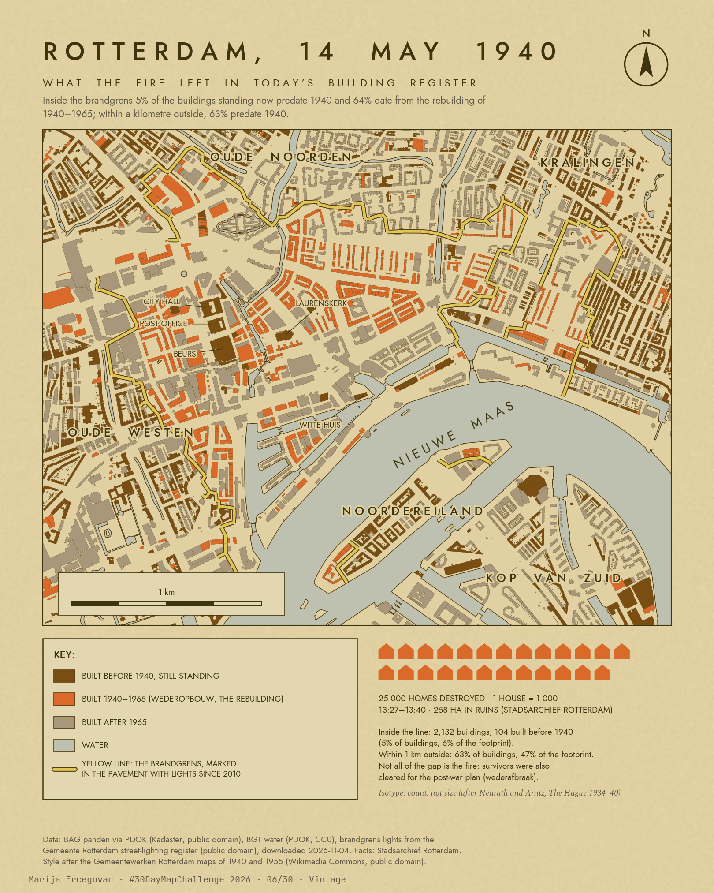

# Day 6, Vintage. Rotterdam, 14 May 1940

Inside the line where the fire of 14 May 1940 stopped, 5 % of the buildings standing today predate 1940; within a kilometre
outside it, 63 % do. Two thirds of the buildings inside date from the rebuilding of 1940–1965, and a third of the listed
monuments inside are themselves post-war. The fire is still legible in the Dutch building register, and in what Rotterdam
now protects.

Style: after Rotterdam's own maps of the bombing and the rebuilding, the GTD plan of 1940 with the brandgrens and the
Gemeentewerken "Oud en nieuw Rotterdam" of 1955 (both public domain on Wikimedia Commons): colours sampled from those scans,
spaced capitals in Jost (OFL) for their Futura / Nobel lettering, a boxed key, an Isotype inset; module
`shared/styles/nl_rotterdam.py`; caption by the series template. The three building periods are pulled apart by lightness
for readability: before 1940 `#7A4E12`, 1940–1965 `#DA6A2A`, after 1965 `#A8977A` (worst-case CIEDE2000 between the periods,
the paper and the water is 12, also under simulated deutan and protan vision; the sampled 1955 colours gave 4.7). The first version, after the 1930s Bonnebladen with Old
Standard TT, is kept as `map_en_old.png` / `map_ru_old.png`.



Animation, 25.5 s: `anim_en.mp4` / `anim_ru.mp4` (1080 × 1350, H.264, no sound; built by `make_anim.py`, not stored in the repository): the centre before the bombing, the fire,
the ash, then every building standing today appearing in its year of construction, with the count per year inside the line.

Russian version: `map_ru.png`. Interactive version with the city's own map of the destroyed area from May 1940 on a slider:
[`index.html`](https://m-erts.github.io/30daymapchallenge-2026/days/06-vintage/). Click any building for its year, address and
use and for what the 1940 map shows on that spot; click a ring for a named building lost in 1940 and what stands there now.

## Question

How much of the city that burned on 14 May 1940 is still pre-war today, and what does the centre now consist of and protect?
The answer matters to the municipality's planners and heritage officers, to developers and renovation programmes working in
the centre, and to anyone telling the story of the bombing with data rather than photographs.

## Data

All downloaded on 4 November 2026.

| Source | What was used | Licence |
|---|---|---|
| Kadaster, BAG via PDOK: [WFS `bag:pand`](https://service.pdok.nl/lv/bag/wfs/v2_0) | 42,823 buildings in RD 89,500–96,000 × 434,500–439,500: footprint, `bouwjaar` (original year of construction), status | public domain: Public Domain Mark 1.0 on the [PDOK page](https://www.pdok.nl/introductie/-/article/basisregistratie-adressen-en-gebouwen-ba-1), CC0 1.0 in the WFS capabilities |
| Kadaster, BAG via PDOK: [WFS `bag:verblijfsobject`](https://service.pdok.nl/lv/bag/wfs/v2_0) | 105,437 addresses in RD 91,000–95,500 × 435,500–439,000, to label buildings in the interactive version | public domain, as above |
| Kadaster, BGT via PDOK: [OGC API `waterdeel`](https://api.pdok.nl/lv/bgt/ogc/v1/collections/waterdeel) | water surfaces; only parts without `eind_registratie` (the API also returns ended versions) | CC0 1.0 |
| Gemeente Rotterdam, public lighting WFS (`ows.gis.rotterdam.nl`, map `bbdwh_pub.map`, layer `ms:sdo_gwr_bsb_ovl`) | the 384 lights of type `Grondspot Medio type Brandgrens`: 350 red, 33 green on the Noordereiland, 1 white | "geen beperkingen", Public Domain Mark 1.0 (Nationaal Georegister record 918e4b3a-6af8-452e-a1fb-6b2f044b3246) |
| Rijksdienst voor het Cultureel Erfgoed (RCE), rijksmonumenten via PDOK: [WFS `ps-ch:rce_inspire_points`](https://service.pdok.nl/rce/ps-ch/wfs/v1_0) | monument points with register number, name and date of designation | CC BY 4.0 (RCE) |
| [Wikidata](https://www.wikidata.org/) SPARQL | items with coordinates in the centre whose demolition date (P576) falls in 1940; 37 buildings kept (cinemas, churches, theatres, synagogues, hospitals, cafés and others), streets, squares, bridges and canals left out; the Laurenskerk left out as it still stands | CC0 1.0 |
| Stadsarchief Rotterdam, archive 4001, [I-210-1A](https://hdl.handle.net/21.12133/CDD9C7CDDCEC43769E8D474193186EF5): plan of the centre with the area destroyed by the bombing of 14 May 1940 and the fire that followed, 1:5000 | the image from the [Rotterdam Time Machine](https://rotterdamtimemachine.nl/) IIIF server at a quarter of full size and their [Allmaps georeference](https://annotations.allmaps.org/images/438842f3998a5f05) (4 control points, affine) | Public Domain Mark 1.0 |

Facts in the captions and texts: [Stadsarchief Rotterdam, Rotterdam in oorlog](https://stadsarchief.rotterdam.nl/rotterdam-oorlog)
(13:27–13:40, 258 ha in ruins, 25,000 homes and 11,000 other buildings, 80,000 homeless);
[Stadsarchief, Op de Coolsingel](https://stadsarchief.rotterdam.nl/op-de-coolsingel) (city hall, post office and the Beurs came
through fairly unscathed); [Laurenskerk, historie](https://laurenskerk.nl/historie/) (burned, restoration finished in 1968);
[West 8](https://www.west8.com/projects/brandgrens-rotterdam/) (the marking of the line, with Opera Graphic Design, 2009–2010);
[Wederopbouw Rotterdam, Wederafbraak](https://wederopbouwrotterdam.nl/en/articles/wederafbraak) (post-war demolition of survivors).

Style references, nothing copied: the 1930s Bonnebladen on [Topotijdreis](https://www.topotijdreis.nl/) (Kadaster; personal,
non-commercial viewing only, so no tiles are used) and the municipal maps of 1940 and 1955 named above. Not used: a scan of the
1955 Gemeentewerken map on [Joods Monument](https://www.joodsmonument.nl/en/page/228487/map-of-rotterdam), marked *reproduceren
verboden*; the lights turned out to be the official line in open data.

## Method

1. **Buildings.** BAG footprints standing today (status in use, being renovated, out of use, demolition permit granted; not
   permits or construction sites), in three periods: before 1940, 1940–1965 (the *wederopbouw*, the rebuilding) and after 1965.
2. **The line.** The lights are numbered `1940-…` and `1941-…`; four lights in Schietbaanstraat, numbered 056–064 and 500 m off the
   line, are left out, which leaves 380. Neighbouring lights of one colour are joined by a minimum spanning tree with edges up to
   160 m: 10.0 km of line, with gaps where no lights are registered. The gaps stay gaps on the map.
3. **The zone, for counting.** Three gaps are closed with straight segments (station and Weena; Oostplein to Admiraliteitskade;
   east of the Plantage), the centre is closed through the Nieuwe Maas, and two pieces on the Noordereiland are closed through the
   river on their north-west side. A building is inside if its representative point is. Comparison: rings around the zone.
4. **The 1940 map.** The affine transform from the Allmaps annotation (fitted in Web Mercator; residuals at the 4 control points
   1.2–1.4 m) is read under every building (majority of a 3 × 3 pixel window, about 5 m): orange = *verwoest gebied*, destroyed;
   a white hole inside the orange area = a building the city marked as repairable or undamaged; anything else = outside.
5. **Heritage.** Each rijksmonument point is joined to the BAG building it stands in (or the nearest within 15 m), which gives it
   a year of construction; monuments are counted by zone and period with their year of designation.
6. **Aggregation in SQL.** Shares by zone and period, the robustness table and the heritage counts are DuckDB SQL over the
   joined tables (`analysis.py`).
7. **Checks.** The headline share is recomputed with the zone shrunk by 50 m, with rings of 0–500 m, 0–1 km and 1–2 km, and with
   the zone taken from the 1940 map instead of the lights. The land area of the zone is compared with the official figure.

## Findings

All numbers from `data/stats.json`.

1. **Inside the line 4.9 % of today's 2,132 buildings predate 1940 (6.0 % of the built footprint); within 1 km outside,
   62.8 % (46.8 %).** The gap holds under every check: 5.3 % with the zone shrunk by 50 m, 9.0 % of buildings (2.4 % of the
   footprint) on the spots the 1940 map shades as destroyed, and 58.6–63.6 % in the outer rings. The land area of the central
   zone, 257 ha, matches the Stadsarchief's 258 ha in ruins.
2. **64.3 % of the buildings inside (1,370) date from the rebuilding of 1940–1965, against 2.9 % within 1 km outside.**
3. **A third of the protected heritage inside is post-war:** 16–18 of the 50 rijksmonumenten inside the line stand in buildings
   of 1940–1965 (designated in 2010 on median, against 1973 for the pre-war monuments inside), against 13 of 251 (5 %) in the
   ring, where 88 % are pre-war. Yet only 1.3 % of the 1,370 post-war buildings inside are listed.
4. **Reading the city's map of May 1940:** 1,960 of today's buildings inside the line stand on spots shaded as destroyed. 93 stand
   where the map marks a building that came through the fire or could be repaired; 74 of these are from 1940 or later, so the
   survivor on that spot was replaced afterwards.

## So what

In the centre of Rotterdam the heritage question is the reconstruction, not the pre-war city: the listed monuments inside the
fire line are increasingly the post-war buildings themselves, while some 1,350 unlisted buildings of 1940–1965 make up two
thirds of the centre's stock. That stock is where decisions on renovation, densification or demolition will fall; ranking it
needs one more open layer, the EP-Online energy labels from RVO (free, but behind an API key), which this analysis could not
use yet.

## Limitations

- `bouwjaar` is the original year of construction recorded by the municipality. For monuments it is nominal (the Laurenskerk has
  1640 in BAG, though the church is older); restored ruins keep their old year and count as survivors.
- The gap inside the line is not only the fire: after the war the city also demolished buildings that had survived, to make room
  for the Basisplan (*wederafbraak*), and the centre has been rebuilt again since. The count does not separate these causes; the
  1940-map reading (finding 4) is an estimate of the second.
- Counts by building favour old streets, where every terraced house is its own BAG building, while a post-war block is often one.
  The footprint share is the fairer comparison.
- The light line is the 2009–2010 reconstruction of the boundary from cadastral maps and the map of the destroyed area, not a 1940
  survey. Where the register has no lights the line has gaps; the counting zone is closed by hand (see Method).
  The 1940 map also marks destroyed blocks on the south bank, which have no lights and are not counted.
- The 1940 map is georeferenced with 4 control points and an affine transform: near block edges the reading can be off by a
  building.
- Monument points are matched to the building they fall in. Two post-war matches designated in 1973 are probably points on a
  neighbouring building, hence the range 16–18. Monuments that are not buildings (bridges, statues, quay walls) have no year.
- Wikidata coordinates of lost buildings are often approximate, and its 1940 end dates have mixed precision (`1940-01-01` means
  "in 1940").
- No energy, use or value data: the map says what period the stock is from, not its condition.
- The animation's fire is an illustration: ignition points are random inside the area the 1940 map shades as destroyed and the
  fire spreads by distance from them. It shows where the fire burned, not how it moved; the order of the raid is not modelled.
  Buildings appear in their BAG year, so buildings that were built and demolished again after 1940 never show up.

## Prior work

- **Bert Spaan at Waag, 2013**: [every building in the Netherlands shaded by year of construction](https://code.waag.org/buildings/),
  9.9 million buildings from BAG ([article](https://waag.org/en/article/map-shows-age-dutch-buildings),
  [code](https://github.com/waagsociety/buildings)); a [2026 version](https://bertspaan.nl/buildings/) with 11.3 million buildings
  ([code](https://github.com/bertspaan/buildings)). Rotterdam's rebuilt centre is visible on it (Waag's project page has a
  Rotterdam view), but its classes join 1919–1945, so the 1940 edge itself is not drawn. This map borrows the idea and cuts the
  register at 1940, against the official line.
- **Rotterdam Time Machine** (a student project of TU Delft Library, Stadsarchief Rotterdam and an MBO Techniek College on
  [Allmaps](https://allmaps.org/), the georeferencing platform of Bert Spaan and Jules Schoonman;
  [code](https://github.com/allmaps/rotterdamtimemachine)): the 1940 map of the destroyed area georeferenced, with the 1940 bomb
  map, the Witteveen plan of 1941, a 1943 aerial photo and the 1946 Basisplan. The interactive version here uses their georeference.
- **Rotterdams Publiek** (Menno den Engelse, Bert Spaan, Stadsarchief and others): [georeferenced Rotterdam maps as open tiles](https://github.com/mmmenno/rotterdams-publiek-data/blob/master/cartografie.md),
  among them a 1955 map of the centre before May 1940.
- **The line itself**: researched by Koos Hage, *Rotterdam, de brandgrens van 14 mei 1940* (Veenman, 2008), as cited on
  [Wikipedia NL](https://nl.wikipedia.org/wiki/Brandgrens_Rotterdam); marked by West 8 with Opera Graphic Design, 385 lights
  since 14 May 2010. The municipality also shows 375 light points in an
  [ArcGIS app](https://rotterdam.maps.arcgis.com/apps/instant/basic/index.html?appid=189a9e99087648a08e5f157e314a2141)
  (no licence stated there); the lighting WFS used here carries a public-domain licence.
- **Andika Hadi Hutama, TU Delft MSc Geomatics thesis, 2026**: uses the 1940 brandgrens map together with BGT building footprints
  ([repository](https://github.com/ahhutama/msc_geomatics_thesis_typst-main)).
- **Building-age layers**: RIVM Atlas Leefomgeving, [Bouwjaar panden (BAG)](https://nationaalgeoregister.nl/geonetwork/srv/metadata/481cff67-ec1c-4c3e-ae6c-813eb3f44601);
  Gemeente Amsterdam, [bouwjaar map](https://maps.amsterdam.nl/bouwjaar/).
- **Frans Blok (3Develop), 2014**: [a double street map of 1939 and now](https://3develop.nl/blog/?p=857), as a picture.
- **Animated building-age maps**: Gemeente Amsterdam's [growth of Amsterdam since 1850](https://maps.amsterdam.nl/bouwjaar/)
  with a time animation over BAG footprints; [Block and Paper](https://blockandpaper.com/skyline), building age in 100 cities
  with a play button, where demolished buildings appear in rust and vanish; Polar Vertex,
  [age of buildings in the Netherlands](https://informationisbeautifulawards.com/showcase/5562-urban-development-in-the-netherlands)
  (OpenStreetMap, Information is Beautiful Awards longlist 2022); Craig Taylor
  ([mapzilla](https://mapzilla.co.uk/work/30daymapchallenge)), Portland's buildings growing in order of construction for an
  earlier #30DayMapChallenge. The Rotterdam fire itself has been staged as a 360° projection in Museum Rotterdam '40–'45 NU
  ([Tinker imagineers, 2015](https://tinker.nl/en/news/rotterdam-blitz-of-may-1940-captured-in-gripping-experience)), not as a map.
  No animation that burns the official destroyed area and then rebuilds it from the building register was found.
- **#30DayMapChallenge**: no earlier entry on Rotterdam 1940 or Dutch building age found (web, LinkedIn, GitHub; X, Bluesky and
  Mastodon are poorly indexed).

What this adds: the official line from the lighting register, the count of what predates 1940 inside it against the city around
it with robustness checks, the heritage cut, and the 1940 map and today's register in one interactive view.

## How to run

Stack: Python 3.13; geopandas 1.1, shapely 2.1, pyproj, networkx, scipy, scikit-image, matplotlib 3.10, Pillow, requests, ffmpeg;
DuckDB 1.5 for the SQL aggregation; Leaflet 1.9.4 for the interactive page. No PostGIS needed.

```
python fetch_data.py            # BAG buildings and addresses, BGT water, brandgrens lights, Wikidata -> data/raw/ (~73 MB, 5–7 min)
python build_brandgrens.py      # lights -> line and counting zone (data/brandgrens_*.geojson)
python make_map.py              # data/stats.json, data/survivors_top40.csv, first version map_*_old.png
python analysis.py              # robustness checks and heritage (DuckDB SQL), adds to data/stats.json, data/monuments.csv
python make_web.py              # web/*.js, web/map1940.webp, the 1940-map reading, rotterdam-1940.html (single file, not in git)
python make_map_gemeentewerken.py   # the main maps map_en.png and map_ru.png (1620 × 2025 px)
python make_anim.py                # anim_en.mp4, anim_ru.mp4 (matplotlib frames piped to ffmpeg in 8 processes, ~2.5 min)
```

`index.html` opens from GitHub Pages or from disk next to its `web/` folder, without a server; sent on its own it shows an empty
map, so send `rotterdam-1940.html` instead. Fonts: Jost and Spectral (OFL) from `shared/styles/fonts/`, Old Standard TT (OFL) in
`fonts/` for the first version.

Analysis: Marija Ercegovac · #30DayMapChallenge day 6
